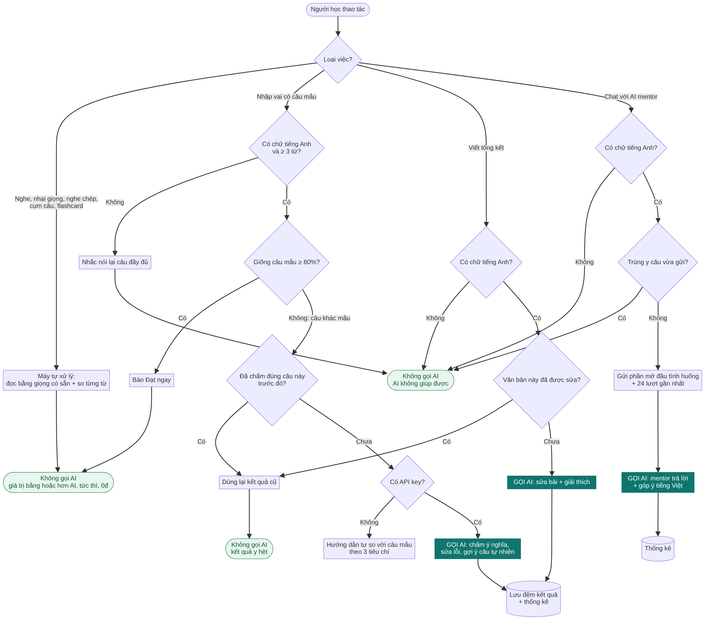
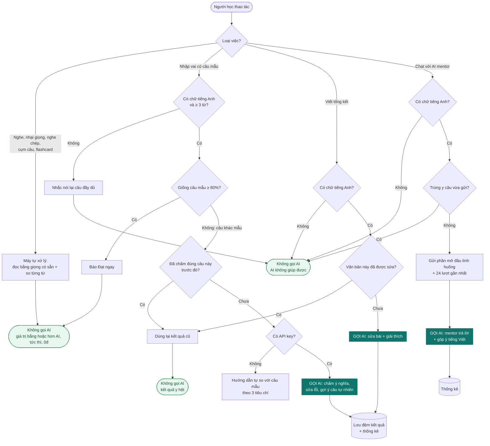

# Khi nào app gọi AI?

## Bài toán

- **Mục tiêu số 1:** người học tiến bộ nhanh nhất. Không giới hạn số lần gọi AI, không tự đổi sang model rẻ hơn.
- **Ràng buộc:** không trả tiền cho AI khi giá trị AI mang lại **≤** cách làm không dùng AI.

Quy tắc quyết định cho mỗi yêu cầu:

> Gọi AI ⇔ **Giá trị(AI) > Giá trị(không AI)**

Giá trị được so trên ba mặt: chất lượng phản hồi cho người học, tốc độ (chấm cục bộ cho kết quả ngay, AI phải chờ vài giây), và việc phản hồi có còn đúng hay không. Ví dụ: chấm phát âm theo câu mẫu bằng cách so từng từ vừa chính xác vừa tức thì, nên AI không thêm được gì.

## Sơ đồ quyết định

Bản mermaid (GitHub tự vẽ):

## Những gì **không** cắt giảm

| Lựa chọn | Lý do giữ |
|---|---|
| Tự đổi sang model rẻ hơn | Làm giảm chất lượng phản hồi, trái với mục tiêu số 1. Model do người học chọn. |
| Giới hạn số lượt chat mỗi ngày | Hội thoại tự do là việc chỉ AI làm được, càng luyện nhiều càng tốt. |
| Bỏ phần góp ý tiếng Việt sau mỗi câu | Đây là giá trị chính khi học. |
| Tắt AI chấm câu trả lời khác mẫu | Máy không tự đánh giá được ý nghĩa và ngữ pháp của câu khác mẫu. |

## Những gì tiết kiệm mà không mất chất lượng

| Kỹ thuật | Tiết kiệm |
|---|---|
| Chấm cục bộ phát âm, nghe chép, flashcard | 100% các lần đó |
| Câu nhập vai giống mẫu ≥ 80% thì báo Đạt ngay | Không cần gọi AI để nói "đúng rồi" |
| Lọc đầu vào rỗng, quá ngắn hoặc trùng | Không trả tiền cho câu trả lời vô ích |
| Lưu đệm kết quả (tối đa 300 kết quả) | Cùng câu hỏi thì dùng lại, không gọi lại |
| Gửi phần mở đầu + 24 lượt gần nhất | Chat càng dài thì mỗi lượt càng ít token; lượt cũ ở giữa hầu như không ảnh hưởng câu trả lời tiếp theo |
| Bộ nhớ đệm prompt (Claude), hoặc đệm tự động (OpenAI, Gemini) | Phần prompt lặp lại được tính giá thấp hơn |
| Mức suy nghĩ `low` cho chat ngắn (Claude 5.x) | Câu trả lời 1–3 câu không cần suy nghĩ sâu |

Thống kê trong ngày (số lần gọi, token ước tính, số lần tự xử lý, số lần dùng lại kết quả cũ) nằm ở **Cài đặt → AI hôm nay**. Code: quyết định nằm ở `src/domain/aiPolicy.js` (hàm thuần, có unit test), thực thi ở `src/application/coach.js`, thống kê và bộ nhớ đệm ở `src/application/usage.js`.
